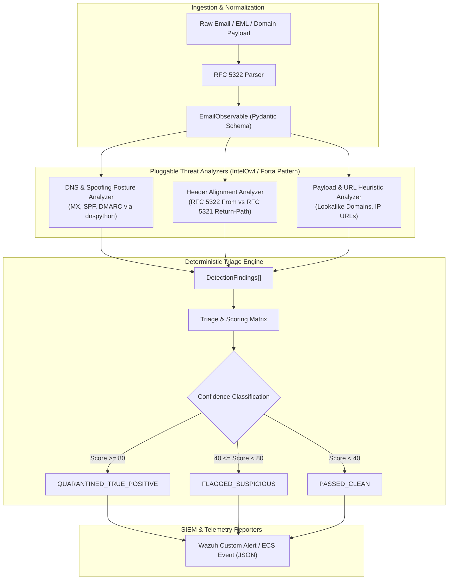

# `phish-signal-interceptor`

[](https://www.python.org/downloads/)
[](#architecture)
[](#detection-and-alert-schema)
[](https://attack.mitre.org/techniques/T1566/)
[](LICENSE)

An open-source, automated Phishing Mail, Domain Posture, and Threat Signal Analyzer engineered for SOC automation, threat intelligence pipelines, and real-time detection engineering.

Designed around the modular analyzer principles of **The Honeynet Project (IntelOwl)** and the deterministic event-monitoring patterns of **Forta Network / Nethermind**, `phish-signal-interceptor` ingests email observables, evaluates sender authentication postures (SPF, DMARC, DKIM), detects header anomalies, and outputs normalized SIEM alerts aligned with **Elastic Common Schema (ECS)** and **Wazuh custom rules**.

---

## Architecture Overview



---

## Directory Structure

```text
phish-signal-interceptor/
├── .github/
│   └── workflows/
│       └── ci.yml               # GitHub Actions CI (pytest + ruff)
├── docs/
│   └── ENGINEERING_LOG.md       # "By Force, By Fire" decision records
├── src/
│   └── phish_signal/
│       ├── __init__.py
│       ├── schemas/             # Typed observable & finding contracts
│       │   ├── __init__.py
│       │   ├── observable.py    # EmailObservable input definition
│       │   └── finding.py       # DetectionFinding & MITRE mapping
│       ├── analyzers/           # Pluggable detection modules
│       │   ├── __init__.py
│       │   ├── dns_posture.py   # SPF/DMARC resolution & spoofing posture
│       │   └── header_parser.py # RFC 5322/5321 alignment & hops
│       ├── engine/              # Scoring & false-positive triage
│       │   ├── __init__.py
│       │   └── triage.py        # Deterministic scoring matrix
│       └── reporters/           # SIEM output formatters
│           ├── __init__.py
│           └── wazuh_ecs.py     # Wazuh/ECS alert serializer
├── tests/
│   ├── fixtures/                # Spoofed sample emails (.eml)
│   ├── test_schemas.py
│   ├── test_dns_posture.py
│   └── test_triage.py
├── requirements.txt
├── requirements-dev.txt
├── TODO.md                      # Time-boxed sprint & study tracker
└── README.md
```

---

## Core Capabilities

- **Zero-Trust Sender Verification:** Resolves DNS MX, SPF, and DMARC TXT records using `dnspython` to uncover soft-fail bypass configurations (`v=spf1 ~all` combined with missing or `p=none` DMARC).
- **Protocol Alignment Checking:** Flags discrepancies between RFC 5322 human-facing `From:` headers and RFC 5321 envelope `Return-Path` addresses.
- **Deterministic Alert Scoring:** Minimizes false positives by calculating multi-vector risk scores rather than single-heuristic alarms.
- **SIEM-Native Format:** Emits structured JSON alerts enriched with MITRE ATT&CK tactics (`T1566.001`, `T1566.002`) ready for Wazuh rules or Elastic SIEM ingestion.
